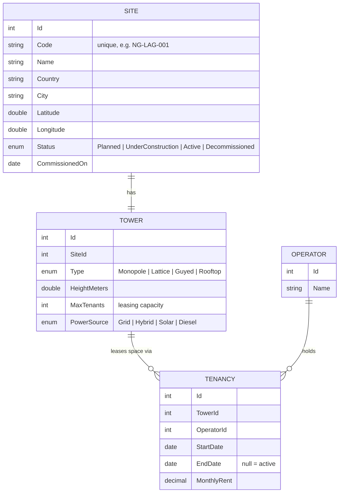
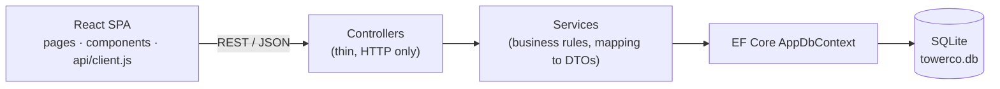

# TowerCo · Tower Management System

A small full-stack app for a fictional tower company: register sites and towers, lease tower space to
mobile operators with capacity checks, search the portfolio and see it on a map/dashboard.

**Stack:** React 18 (Vite) · ASP.NET Core 8 Web API · EF Core · SQLite

## Repository structure

```
├─ backend/            ASP.NET Core 8 Web API  → see backend/README.md
│  └─ TowerCo.Api/
├─ frontend/           React + Vite SPA        → see frontend/README.md
├─ TowerCo.sln         Visual Studio solution (backend)
└─ nuget.config        package source (nuget.org)
```

- [Backend README](backend/README.md): API structure, endpoints, business rules
- [Frontend README](frontend/README.md): UI structure, pages, scripts

## Quick start

**Prerequisites:** [.NET 8 SDK](https://dotnet.microsoft.com/download/dotnet/8.0) and [Node.js 18+](https://nodejs.org/).

```bash
git clone <repository-url>
cd <repository-folder>

# 1. API  → http://localhost:5234/swagger
cd backend/TowerCo.Api
dotnet run

# 2. Frontend (in a second terminal)  → http://localhost:5173
cd frontend
npm install
npm run dev
```
The SQLite file `towerco.db` is created and seeded with fictional data on first run.
Delete it to reset the demo data. No other setup (database server, API keys) is needed.

## Use cases → where they live

| # | Use case | UI | API |
|---|---|---|---|
| 1 | Manage tower sites | *Register site* / *Edit site* | `POST /api/sites`, `PUT /api/sites/{id}` |
| 2 | Assign tenants + see capacity | Site detail → Tenants | `POST /api/sites/{id}/tenancies`, `DELETE /api/tenancies/{id}` |
| 3 | Find sites | *Sites* (search, country, status) → site detail | `GET /api/sites?search=&country=&status=`, `GET /api/sites/{id}` |
| 4 | Visualise portfolio | *Dashboard* (KPIs, map, charts) | `GET /api/dashboard` |

## Domain model



**Design choices**
- **Site vs Tower** – the site is the location and its status; the tower is the physical asset and
  its capacity. Kept 1:1 for now, but separate so a site could hold more structures later.
- **Tenancy** is the link between an operator and a tower (many-to-many with its own data: dates, rent).
  Ending a lease sets `EndDate` instead of deleting, so history is kept.
- **Capacity** is derived, never stored: `AvailableSlots = MaxTenants − active tenancies`.
- **Business rules** (service layer, returned as `409` ProblemDetails):
  tower full · operator already on the tower · site not Active · duplicate site code ·
  capacity reduced below current tenants.

## Architecture



Detailed folder layouts are in the [backend](backend/README.md) and [frontend](frontend/README.md) READMEs.

**Why these choices**
- **SQLite + EF Core** – zero setup, a single file; swapping to Azure SQL is a one-line provider change.
- **Controllers → Services** – controllers stay thin; rules are in one testable place.
- **DTOs** – the API contract is decoupled from the database model.
- **`EnsureCreated` + seed** – simplest for a demo; production would use EF migrations.
- **Frontend** – no UI kit, just plain CSS; Leaflet (OpenStreetMap) for the map, Recharts for charts.
  Site list filters live in the URL so filtered views can be shared.

## Next steps (if this were production)
Authentication/roles (operations vs commercial vs manager) · EF migrations · paging on the site list ·
unit tests for the services · hosting on Azure App Service + Azure SQL + Static Web Apps.

## Ideas for a live change
- Add a field (e.g. `Tower.Owner` or `Site.Region`): entity → `SaveSiteRequest`/DTO → `Mappings` → `SiteForm` → detail page.
- Add a filter (e.g. tower type): `SiteService.SearchAsync` + a `<select>` in `SiteList`.
- Change a rule (e.g. allow tenants on `UnderConstruction` sites): `TenancyService.AddAsync`.
